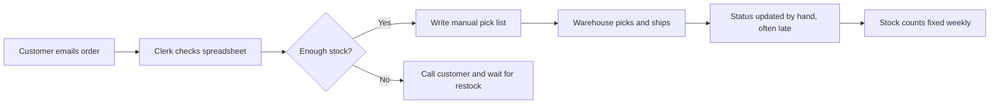
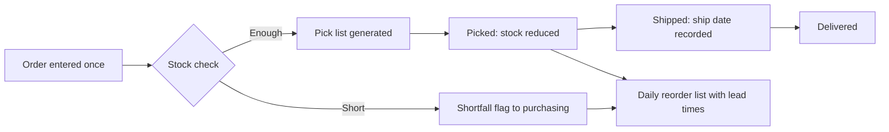
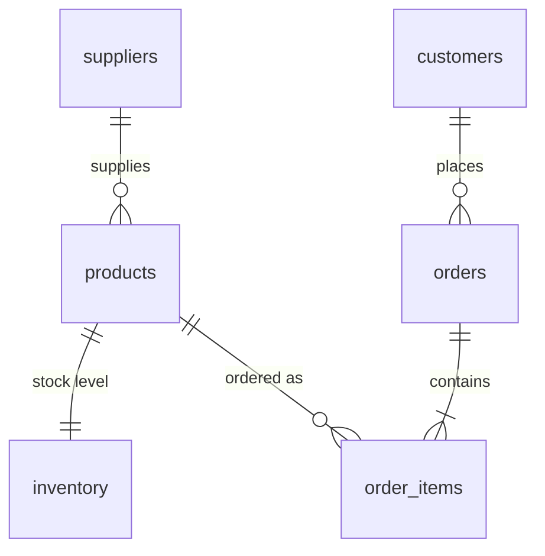

# Inventory & Order Tracking: a business analysis case study

> **Practice sample.** The company, products and numbers are hypothetical, created for this exercise. They are not employer data and not work experience. The analysis, SQL, tests and documents are real.

## 1. The process, before and after

## 2. The dashboard

| Measure | Value |
|---|---|
| Products at or below reorder point | 4 |
| Lowest category margin | 50.4% (Beverage) |
| Slowest region, average days to ship | 6.0 (South) |
| Largest customer share of revenue | 27.6% |
| Open orders that exceed stock | 0 |
| Total revenue, excluding cancelled orders | $2,138.71 |

Full charts: [Inventory_Dashboard.xlsx](Inventory_Dashboard.xlsx). Live queries: https://aaronmadewell.github.io/

## 3. Data model

See [data_dictionary.md](data_dictionary.md), [schema_v1.1.sql](schema_v1.1.sql), [seed.sql](seed.sql) and [queries.sql](queries.sql).

## 4. Requirements

Twelve user stories with Given / When / Then acceptance criteria: [user_stories.md](user_stories.md).

## 5. Testing and defects

Fifteen test cases traced to the stories: [traceability.md](traceability.md). Run `python run_uat.py schema_v1.1.sql v1.1 --fk-on`.

My first schema (v1.0) passed 13 of 15 tests. The two failures were real defects, now fixed in v1.1 (15 of 15): see [defects.md](defects.md).

## 6. Backlog

[backlog.csv](backlog.csv) (Jira-importable) and [sprint_plan.md](sprint_plan.md).
